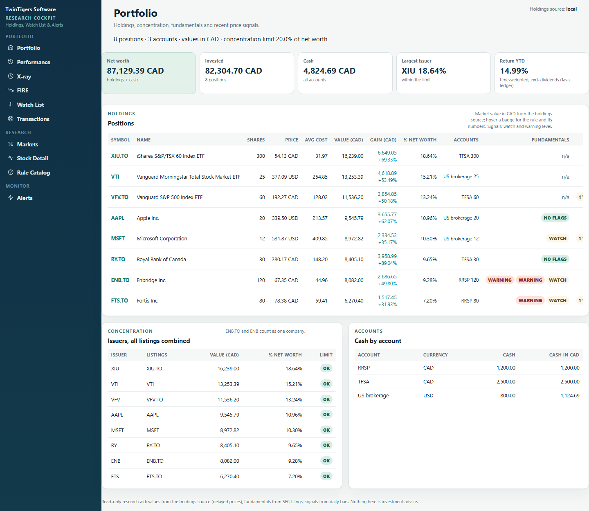
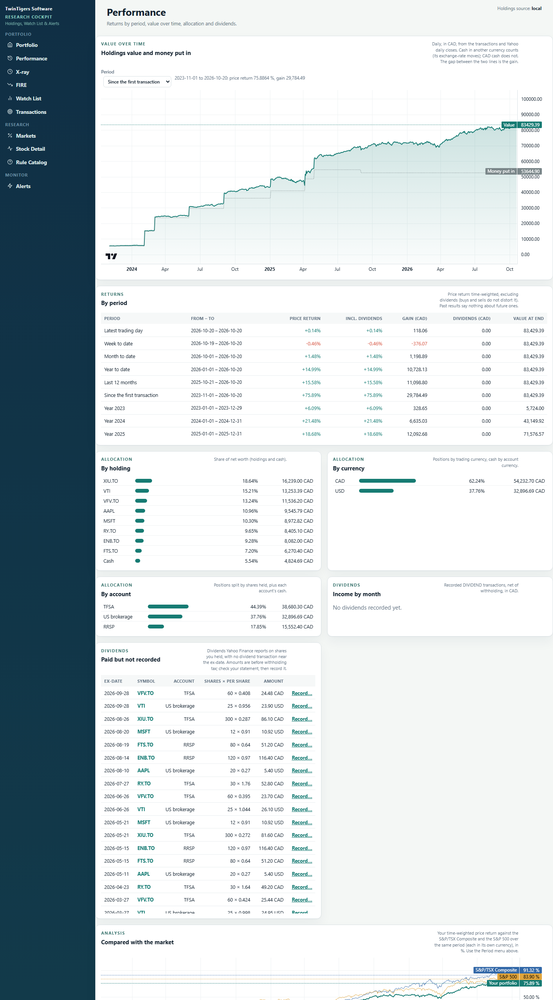
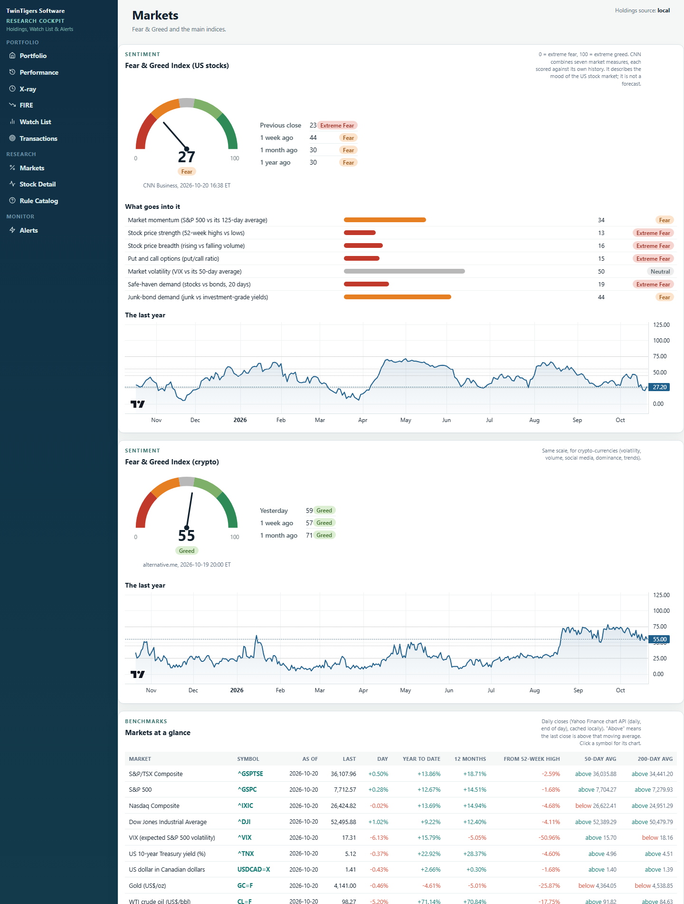
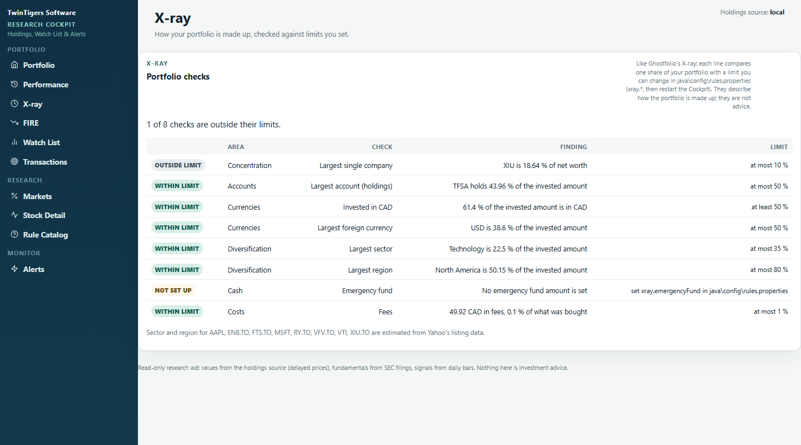

# Twintigers Stock Research Cockpit

**Version 1.0.0** · [Release notes](RELEASE_NOTES.md) · Apache-2.0

A private, self-hosted investment research workstation that runs on your own computer. It tracks your accounts and
transactions, charts your holdings and the markets, audits companies from their SEC filings, watches price levels for
you, and gives Claude (or any MCP client) sourced research tools. Nothing leaves your machine except requests for
public market data.

> **Not investment advice.** The tools present facts with their sources and formulas. Price signals describe what
> price and volume did; the project's own replay found no reliable edge in them. Decide for yourself.

## What you get

| Page | What it does |
|---|---|
| **Portfolio** | Holdings with value, average cost and gain, concentration by company, fundamental flags, recent signals |
| **Performance** | Time-weighted returns by period and year, value over time, comparison with the S&P/TSX and S&P 500, best/worst holdings, money put in, allocation (holding, currency, account, asset class, sector, region, country), dividends and unrecorded dividends |
| **X-ray** | Checks of how the portfolio is made up (concentration, currencies, sectors, regions, emergency fund, fees) against limits you set |
| **FIRE** | Safe-withdrawal amount from today's net worth and a projection |
| **Transactions** | Accounts and cash (add, change, move between accounts), buys, sells and dividends; every change is previewed and confirmed |
| **Watch List** | Stocks you follow, with notes, alert distance and signals |
| **Markets** | CNN Fear & Greed Index (with its components and history), crypto Fear & Greed, major indices, rates, currency, gold, oil |
| **Stock Detail** | Quote-style chart (1D–Max, dates, candle/line/area, 50/200-day averages, volume, log scale, drag-to-zoom, overview), "why did this signal fire", your position, SEC financial health |
| **Alerts** | Price alerts (above, below, % move, ATR trailing stop) checked every 30 minutes, with phone notifications through ntfy |



| Stock Detail | Performance |
|---|---|
|  |  |
| **Markets** | **X-ray** |
|  |  |

Screenshots show a made-up sample portfolio. More in the [user guide](docs/cockpit/README.md).

## Quick start

You need **Docker Desktop** (Windows, macOS or Linux). Nothing else: the Java app is built inside Docker.

**Windows:** double-click `start.cmd`. The first time, it creates `secrets.env`. Put your name and email in
`SEC_USER_AGENT` (the SEC asks for it), then double-click `start.cmd` again. The first build takes about 5 minutes,
then the Cockpit opens at <http://localhost:8099>. `stop.cmd` stops it.

**macOS / Linux:**

```sh
cp secrets.env.example secrets.env     # then edit SEC_USER_AGENT
mkdir -p backups
docker compose up -d --build
open http://localhost:8099             # or xdg-open
```

Then, on the **Transactions** page: **Add an account**, then record your buys (and later sells and dividends). Prices
come from Yahoo Finance, so use Yahoo symbols: `ENB.TO` for the TSX, `IBM` for US listings.

## Everyday use

| Task | How |
|---|---|
| Start / stop | `start.cmd` / `stop.cmd` (or `docker compose up -d` / `docker compose stop`) |
| Status | `powershell -ExecutionPolicy Bypass -File scripts\status.ps1` (or `docker compose ps`) |
| After editing `secrets.env` or `java/config/rules.properties` | `powershell -ExecutionPolicy Bypass -File scripts\cockpit.ps1 -Restart` |
| Update after pulling new code | `start.cmd` again (it rebuilds what changed) |
| Logs | `docker compose logs -f research-cockpit research-monitor` |
| Phone alerts | Install the [ntfy](https://ntfy.sh) app, subscribe to a long random topic, put it in `NTFY_TOPIC` in `secrets.env` |

The containers restart with Docker Desktop. On Windows, Docker Desktop can start at login (Settings → General).

## Your data and backups

- Everything you enter (accounts, transactions, watch list, alerts) is in the Docker volume
  `twintigers_research-data`. Every evening the monitor copies it to `backups/research-YYYY-MM-DD.db` (newest 14 kept).
  Copy `backups/` somewhere else (cloud drive, USB) for an off-machine copy.
- `docker compose down -v` would delete the volume; no script here runs it.
- `secrets.env`, `portfolio.toml` and `backups/` are in `.gitignore`. Keep it that way.

## Configuration

| File | What |
|---|---|
| `secrets.env` | `SEC_USER_AGENT`, ntfy topic, optional Alpha Vantage key ([example](secrets.env.example)) |
| `java/config/rules.properties` | Thresholds for the health audit, price rules, X-ray limits (`xray.*`), alert cooldown, Markets benchmarks |
| `java/config/holidays/` | TSX and NYSE holidays (add next year's each December) |

## Using it with Claude

Open [Claude Code](https://claude.com/claude-code) in this folder: `.mcp.json` connects the **research-java** MCP server,
which runs inside the Cockpit container. Try the prompts in [examples/prompts.md](examples/prompts.md). Tools:
`financial_health`, `price_signals`, `replay_rules`, `portfolio_review`, `rule_catalog`, `add_alert`, `list_alerts`,
`remove_alert`, `mute_alert`, `alert_status`. Rules for answers are in [CLAUDE.md](CLAUDE.md).

## How it is built

Java 25, hexagonal (domain → ports → application → adapters → apps), no framework: JDK HTTP server, htmx and
TradingView Lightweight Charts in the browser, SQLite with Flyway, the MCP Java SDK. Data: SEC EDGAR (fundamentals),
Yahoo Finance (prices, intraday, dividends, splits, search; unofficial and delayed), CNN and alternative.me (Fear &
Greed). Design and decisions: [docs/architecture/overview.md](docs/architecture/overview.md) and the ADRs in
[docs/architecture/adr](docs/architecture/adr).

**Develop:** JDK 25+ and Maven, then `cd java` and `mvn verify` (unit, property, contract, WireMock and ArchUnit
tests). `start.cmd` rebuilds the image.

## Data sources and their terms

This project calls free public endpoints for personal, low-volume use: SEC EDGAR (fair-access policy: identify yourself
in `SEC_USER_AGENT`, stay under 10 requests per second), Yahoo Finance's chart and search endpoints (unofficial, no
guarantee, may change), CNN's Fear & Greed data (unofficial), alternative.me's crypto index and ntfy.sh. Respect their
terms; responses are cached locally to keep traffic low.

## License

[Apache License 2.0](LICENSE). Copyright 2026 Twintigers; see [NOTICE](NOTICE) and
[THIRD-PARTY-NOTICES.md](THIRD-PARTY-NOTICES.md). What is new in each version: [RELEASE_NOTES.md](RELEASE_NOTES.md).
