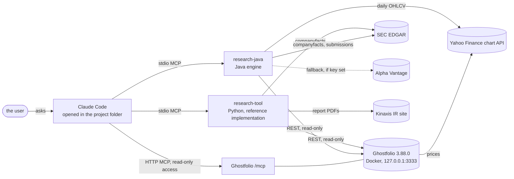
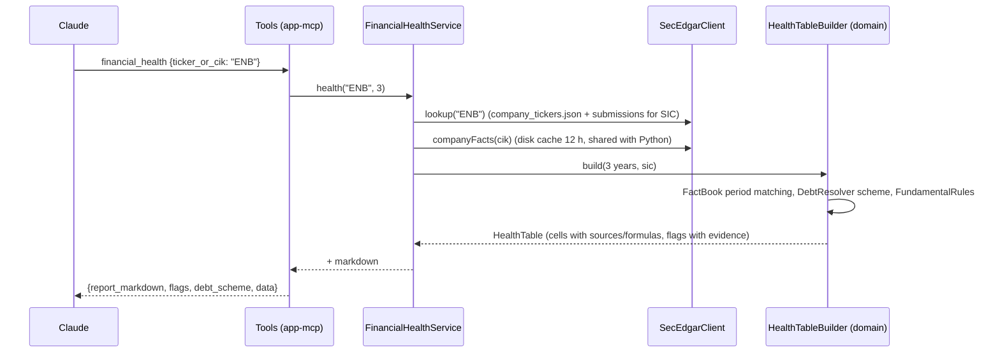

# Architecture overview

A personal, read-only research assistant. Claude Code asks questions through MCP servers; the servers return
sourced numbers, formulas and rule results; Claude explains them. Nothing places orders or changes data.

## Context



Both research servers run side by side. The Python server stays the reference ("oracle") until the Java engine
reproduces its numbers on the same inputs (ADR 0003); today the Java engine covers SEC fundamentals, price rules
and the portfolio review, while Kinaxis report-PDF parsing, position sizing and the Ghostfolio detail tools stay
on Python.

## Modules (java/)

Hexagonal ("ports and adapters"): rules and calculations in the middle, I/O at the edge. Dependencies point
inward only, and ArchUnit fails the build if they don't (`arch-tests/LayeringTest`).

```mermaid
flowchart TB
    subgraph apps[Applications]
        MCP[app-mcp<br/>McpMain, Tools]
        WRK[app-worker<br/>WorkerMain]
        CLI[cli<br/>CliMain, Parity]
    end
    subgraph adapters[adapters]
        SECA[sec.SecEdgarClient]
        YA[market.YahooChartClient<br/>AlphaVantageClient<br/>FallbackMarketData<br/>CachedMarketData]
        SQ[store.SqliteBarStore<br/>Flyway V1__bars.sql]
        GFA[ghostfolio.GhostfolioClient]
        HTTP[http.Http<br/>Resilience4j retry]
        CFG[config.Settings<br/>secrets.env + rules.properties]
        WIR[Wiring]
    end
    subgraph application[application]
        FHS[FinancialHealthService]
        PSS[PriceSignalService]
        PRS[PortfolioReviewService]
        REP[Reports, HealthMarkdown]
    end
    subgraph ports[ports]
        P1[CompanyDirectory]
        P2[CompanyFactsSource]
        P3[MarketData]
        P4[BarStore]
        P5[PortfolioSource]
    end
    subgraph domain[domain: pure Java, no I/O]
        PROV[provenance<br/>Fact, Calc, Cell]
        FUND[fundamentals<br/>FactBook, HealthTableBuilder,<br/>DebtResolver, FundamentalRules]
        MKT[market<br/>Bar, Indicators, Levels,<br/>PriceRules, RuleEngine]
        PORT[portfolio<br/>Portfolio, IssuerWeight]
    end
    apps --> adapters --> application --> ports --> domain
    application --> domain
```



| Module | Holds | May use |
|---|---|---|
| domain | Sourced values (`Fact`, `Calc`, sealed `Cell`), the health table, debt resolution, fundamental rules, indicators, price/candlestick rules, replay statistics, portfolio weights | `java.*` only (no I/O, no clock, no JSON) |
| ports | Interfaces for SEC data, market data, the bar cache, the portfolio | domain |
| application | Use cases and markdown rendering | ports, domain |
| adapters | HTTP clients, JSON parsing, SQLite, configuration, wiring | everything above, Jackson 3, Resilience4j, sqlite-jdbc, Flyway |
| app-mcp | MCP server (stdio), tool schemas | adapters, MCP Java SDK 2.1.0 |
| cli | `health`, `signals`, `replay`, `review`, `parity`, `rules`, `alerts` | adapters |
| app-worker | Scheduled monitor: `run --mode auto`, `status`, `test-notify` | adapters |
| app-web | Stock Research Cockpit, http://127.0.0.1:8099: JDK HttpServer, server-rendered pages in the Twintiger Retirement Planner's layout (its CSS vendored unmodified), htmx, Lightweight Charts | adapters |
| arch-tests | Layering rules | all, test scope |

No framework: wiring is one constructor (`Wiring`). Java 25 language level (compiled with the installed JDK 26).

## Data flow

**financial_health(ticker)**



**price_signals(symbols)**: `PriceSignalService` asks `MarketData` for the window plus 400 calendar days of
history. `CachedMarketData` serves it from SQLite if the symbol was fetched today, otherwise calls
`FallbackMarketData` (Yahoo, then Alpha Vantage if a key is configured) once and stores the bars. The domain
builds a `MarketContext` (ATR, SMA20, RSI, MACD, prior average volume computed once), and `RuleEngine` tests every
rule on every day in the window. Each `Signal` carries its evidence.

**portfolio_review**: `GhostfolioClient` (security token → JWT, GET only) gives positions, cash and per-account
shares; the domain computes issuer weights across listings; each issuer gets its SEC flags (T → TU; Kinaxis has
no SEC data) and each listing its recent signals.

## Data and secrets

| Item | Where | Notes |
|---|---|---|
| SEC responses | Docker volume `twintigers_research-data` (`company_tickers.json`, `companyfacts/`, `submissions/`); on Windows `~/.cache/research-tool/` for Python and the CLI | The live parity check runs on Windows so both read identical inputs |
| Daily bars, alerts, outbox, heartbeat, watch list, ledger | `research.db` (SQLite, WAL) in the Docker volume `twintigers_research-data`; nightly copy in `backups/` | V1 `bars`, `fetch_log`; V2 `alerts`, `subscriptions`, `outbox`, `runs`, `holdings_cache`; Flyway |
| Holidays | `java/config/holidays/TSX.txt`, `NYSE.txt` | Add each year |
| ntfy topic | `secrets.env` (`NTFY_TOPIC`, `NTFY_URL`, optional `NTFY_TOKEN`) | Anyone with the topic can read it |
| Secrets | `secrets.env` (gitignored) | `SEC_USER_AGENT`, `GHOSTFOLIO_TOKEN`, optional `ALPHAVANTAGE_API_KEY`; never logged |
| Thresholds | `java/config/rules.properties` | All defaults listed; edit and reconnect |

## Quality gates

`mvn verify` runs: domain unit tests (each rule on a textbook example), jqwik properties (RSI bounds, ATR ≥ 0,
buyer/seller mirror symmetry, no look-ahead), the golden parity test against Python's output for the synthetic
SEC fixture, WireMock adapter tests (request shape, retries, error messages without secrets, the once-a-day
cache), and ArchUnit layering. `research-cli parity` repeats the parity check live on ENB, TU, FTS, BNS and IBM
(`docs/parity/health-parity.md`).

## Alerts and notifications (slice 2)

The user's threshold alerts (above, below, % move from a reference, ATR trailing stop) and rule subscriptions live in
SQLite; they are the only data the system writes on the user's behalf (MCP tools `add_alert`, `list_alerts`,
`remove_alert`, `mute_alert`, `alert_status`; CLI `alerts ...`). Guide: `docs/alerts/user-guide.md`.

```mermaid
sequenceDiagram
    participant TS as research-monitor (Docker, loop)
    participant W as research-worker
    participant E as AlertEngine
    participant DB as SQLite (alerts, outbox, runs)
    participant N as Notifier (ntfy)
    TS->>W: run AUTO every 30 min on the clock
    W->>E: run(AUTO)
    E->>E: resolve mode from clock + holiday files (intraday / close once a day / nothing)
    E->>DB: stale check (last successful run > 1 trading day?)
    E->>E: holdings (Ghostfolio, else cached list) + alert symbols
    E->>E: thresholds: quote (intraday) or close; state machine ARMED → TRIGGERED → (cooldown, cleared) → ARMED
    E->>E: close only: price rules on the final bar, fundamental flags; match subscriptions
    E->>DB: enqueue (dedupe key × channel, INSERT OR IGNORE)
    E->>N: dispatch due rows; failures retried with back-off
    E->>DB: heartbeat (runs)
```

Default subscriptions come from the replay (`alerts tune-defaults`): warning rules with ≥ 10 fires and ≥ 55 %
20-day hit rate on the holdings (today only K05 dark cloud cover), plus all fundamental warnings. ADRs 0006 (Task
Scheduler, superseded by 0009: Docker) and 0007 (ntfy through an outbox).

## Stock Research Cockpit and replaceable holdings source (slice 3)

The Cockpit (`app-web`, guide `docs/cockpit/README.md`) renders Portfolio, Watch List, Stock Detail (K-line chart with
signal markers and alert lines, health table), Rule Catalog and Alerts on the server with the Twintiger Retirement
Planner's markup and vendored stylesheets (`static/vendor/twintiger/VENDOR.md`); htmx posts forms; Lightweight Charts
draws the chart from `/api/chart/{symbol}`. It binds to 127.0.0.1, answers only Host localhost/127.0.0.1, needs a
per-start token on every POST, and sends a strict CSP. `CockpitService` (application) builds the views from ports only.

Holdings come through `PortfolioSource` (ADR 0008): Ghostfolio or the local portfolio.toml source, chosen by
`PORTFOLIO_SOURCE`; both pass the shared `PortfolioSourceContract`; ArchUnit keeps source adapters out of every class
but `Wiring`. The watch list (`WatchlistStore`, schema V3) and alerts live in our own database, so a swap loses nothing.
Adding a broker: `docs/architecture/portfolio-sources.md`.

Transactions are recorded through a second port, `PortfolioWriter` (create/update/delete an `ActivityDraft`, validated
in the domain first). Ghostfolio implements it over its activities REST API (off unless `GHOSTFOLIO_WRITES=enabled`);
the local source keeps a `ledger` table (schema V4) and derives holdings from it. Both pass `PortfolioWriterContract`.
The Transactions page is two-step: Review shows the exact change, only Confirm writes.

Rule tuning (`application.RuleTuner`, CLI `tune-rules`): a fixed menu of stricter variants per directional rule
(`domain.market.Refinement`: volume, 200-day trend, prior move, next-day confirmation) is scored on the older
in-sample years; the choice is kept only if it also clears the bar on the newer out-of-sample years, otherwise the rule
is set to info. Results: `docs/alerts/rule-tuning.md`.

## Not built yet (next slices)

- Real-time intraday data: the `IntradayData` port and the Cockpit's intraday chart exist (ADR 0011) with Yahoo's delayed
  bars; a paid or broker feed would be another adapter, and a push stream a separate port.
- Kinaxis report-PDF parsing in Java (PDFBox), then retire the Python server once parity covers everything it does.
- Valuation (P/E, DCF), dividend tracking.
