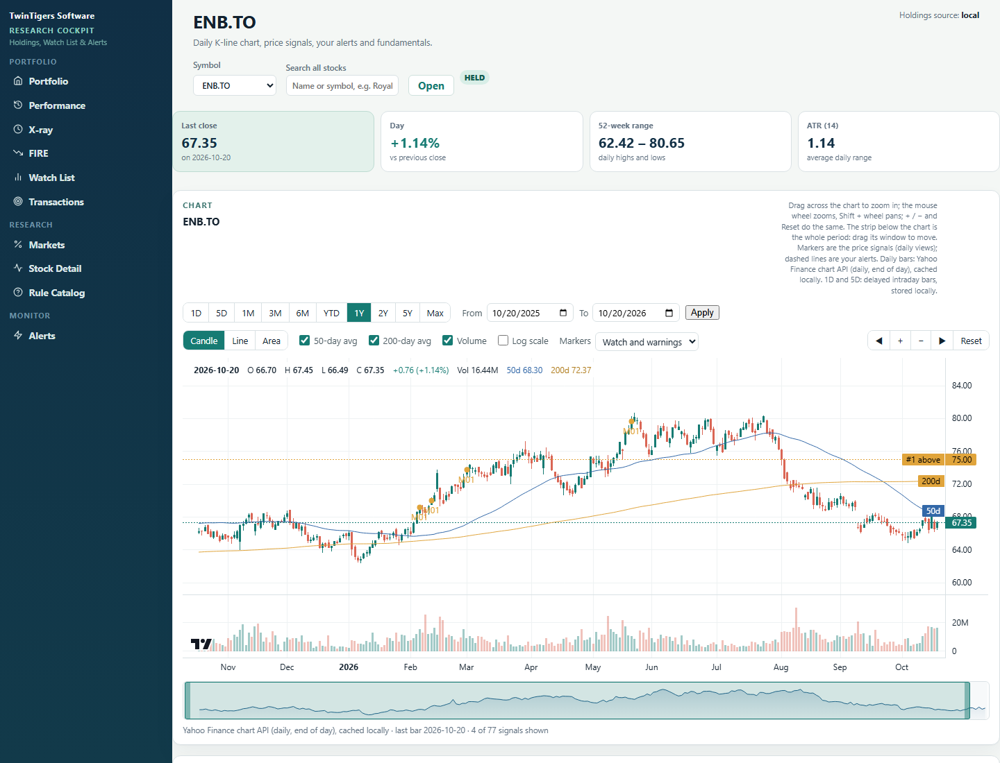
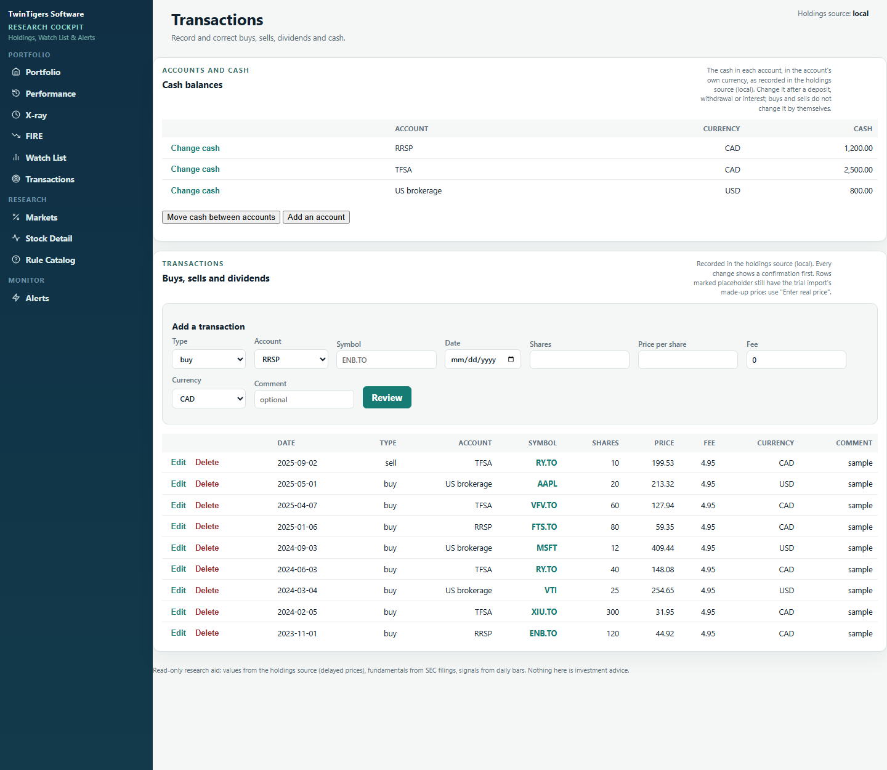
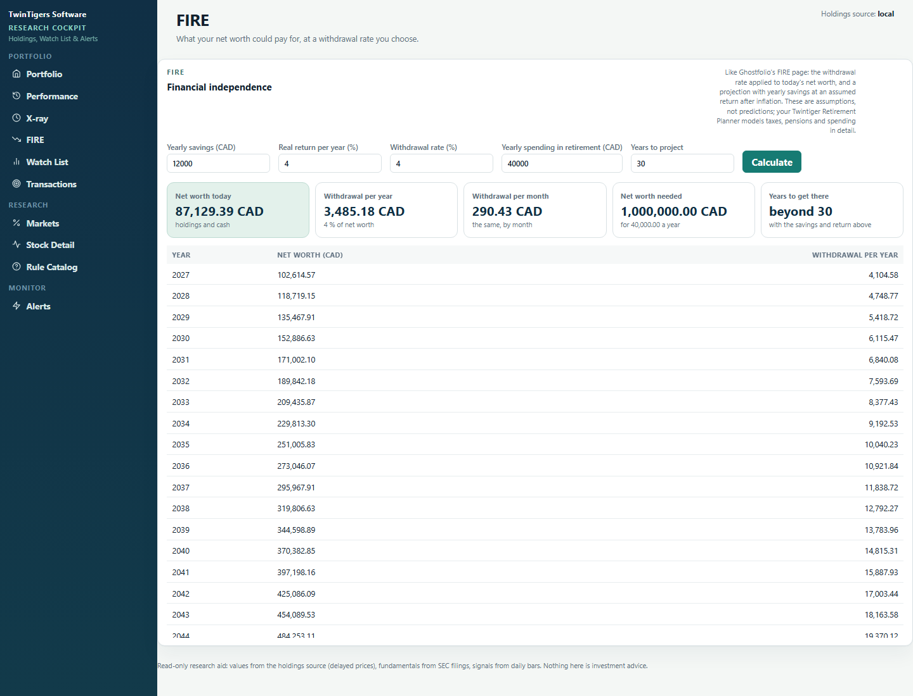

# Stock Research Cockpit: user guide

The web app at <http://localhost:8099>, reachable from this computer only. Start it with `start.cmd` (or
`docker compose up -d`); `scripts\cockpit.ps1` opens it, `-Restart` restarts it after you edit `secrets.env` or
`java/config/rules.properties`.

## Getting started

1. **Transactions → Accounts and cash → Add an account** for each account (name, currency, cash now).
2. **Transactions → Add a transaction** for each buy (and later sells and dividends). Symbols are Yahoo's: `ENB.TO`
   for the TSX, `IBM` for US listings. Every change shows "Please confirm" first; nothing is written until **Confirm**.
3. Open **Portfolio**. Add stocks you follow on **Watch List**, and price alerts on **Alerts** or Stock Detail.

## Pages

| Page | What it shows |
|---|---|
| **Portfolio** | Net worth, invested, cash, largest company, return year to date; every position with price, average cost, value, gain, % of net worth, shares per account, fundamental flags and recent signals; concentration by company (listings combined, e.g. ENB.TO + ENB); cash by account. |
| **Performance** | Returns for the latest trading day, week, month, year to date, 12 months, since the first transaction and each past year: price return (time-weighted, excluding dividends), return including dividends, gain, dividends, value. Value against money put in over time; your return against the S&P/TSX and S&P 500; best and worst holdings; money put in by month. Allocation by holding, currency, account, asset class, sector, region and country. Dividend income by month, and dividends paid on your shares that are not recorded, each with **Record…** (opens the transaction form filled in; check the amount on your statement). |
| **X-ray** | How the portfolio is made up, checked against limits you set: largest company, largest account, share in your base currency, largest foreign currency, largest sector and region, emergency fund, fees. Limits: `xray.*` in `java/config/rules.properties`. |
| **FIRE** | A withdrawal rate (4 % by default) applied to today's net worth, per year and per month; with yearly savings, an assumed return after inflation and your yearly spending: the net worth needed and a year-by-year projection. Assumptions, not predictions. |
| **Transactions** | **Accounts and cash**: add an account, change its cash (after a deposit, withdrawal or interest), move cash between accounts (between currencies at the latest daily rate, or the amount you type). Below: buys, sells and dividends, with **Edit** and **Delete**. Every change is previewed (now / after) and confirmed. |
| **Watch List** | Stocks you follow, owned or not: last close, day change, 52-week range, nearest alert and its distance, fundamentals, recent signals, your note (saved when you leave the box). |
| **Markets** | CNN's Fear & Greed Index (gauge, previous close / week / month / year, its seven components, a year of history) and the crypto index; indices, rates, USD/CAD, gold, oil and bitcoin with day, year-to-date and 12-month change, distance from the 52-week high and position vs the 50/200-day averages. Change the list with `market.benchmarks`. |
| **Stock Detail** | Pick a holding or watch-list stock, or search any stock by name. Chart: **1D … Max** or **From/To**; **Candle / Line / Area**; **50-day** and **200-day** averages; **Volume**; **Log scale**. Zoom by dragging across the chart, with the mouse wheel (Shift + wheel pans) or **◀ + − ▶ Reset** (keys + − ← → 0). The strip under the chart is the whole period: drag its window or its edges. The readout at the top shows the bar under the cursor. 1D and 5D use Yahoo's intraday bars (delayed about 15 minutes, with VWAP and the previous close, refreshed every minute while the market moves, stored locally). Daily views show the price signals: **click one** to see why it fired. Also: your position (cost, gain, transactions) and the SEC financial-health table with sources (hover a number). |
| **Rule Catalog** | The definition of every price rule and the thresholds in force. |
| **Alerts** | Add, mute or remove price alerts and rule subscriptions; the monitor's recent runs; notifications sent. Guide: [../alerts/user-guide.md](../alerts/user-guide.md). |

Prices are Yahoo Finance's: delayed quotes for the Portfolio page, final daily closes for the charts (today's bar is
final after 16:15 Eastern). Nothing here is investment advice.

## Safety

The Cockpit listens on 127.0.0.1 only and answers only to `localhost`. Every change needs a token issued when it starts,
scripts load only from the Cockpit itself, and it never places orders. It writes only your own data: accounts, cash,
transactions, watch list and alerts.

## Rule tuning

`docker exec research-cockpit java -jar /app/research-cli.jar tune-rules --write-config` replays every warning/watch
price rule over 5 years, chooses stricter variants on the older part only and checks them on the newer part. Rules
that don't hold are set to info in `java/config/rules.properties`. Method and result: [../alerts/rule-tuning.md](../alerts/rule-tuning.md).

## Other holdings sources

The Cockpit reads holdings through a port (`PortfolioSource`), so a broker API or another tracker can be added: see
[../architecture/portfolio-sources.md](../architecture/portfolio-sources.md). A one-off copy from a running
[Ghostfolio](https://ghostfol.io) is built in: set `GHOSTFOLIO_URL` and `GHOSTFOLIO_TOKEN` in `secrets.env`, restart, then
`docker exec research-cockpit java -jar /app/research-cli.jar ledger-sync`.
